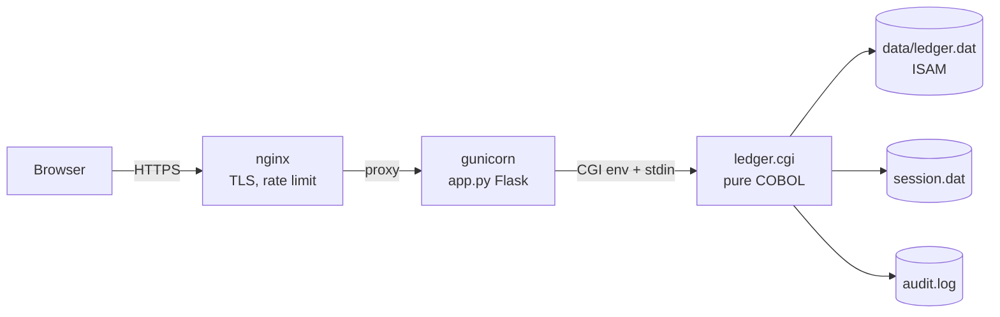

# 📜 The Ledger of Ages

[](https://github.com/Alexandru2984/cobol/actions/workflows/ci.yml)

A personal finance ledger web application whose **entire backend is written in pure COBOL** (GnuCOBOL), storing data in native **ISAM indexed files** and speaking **CGI** — deployed in production behind nginx + gunicorn.

Live at [cobol.micutu.com](https://cobol.micutu.com).

---

## ✨ Features

- **Full CRUD** — add, edit (pre-filled form), and delete transactions
- **Authentication with hashed passwords** — the password is verified against a SHA-256 digest (`LEDGER_PASS_HASH`) computed by a **pure-COBOL SHA-256 implementation** (`sha256.cbl`, FIPS 180-4, validated against official test vectors); no plaintext secret needs to live in the environment
- **Multiple concurrent sessions** — tokens live in an ISAM file with per-token expiry (8h default); logging in on your phone no longer kicks out your laptop; expired sessions are lazily purged
- **Brute-force lockout** — 5 failed logins from an IP lock that IP out for 15 minutes, tracked in an ISAM file, all in COBOL
- **Filtering, search & sorting** — by category, date range (via the ISAM *alternate key* on date), case-insensitive substring search in descriptions, sorted by ID or date
- **Pagination** — 20 rows per page with prev/next links that preserve active filters (percent-encoding done in COBOL)
- **Monthly report** — income/expense/net per month with a pure-CSS bar chart (zero JavaScript)
- **CSV export** — respects active filters, proper RFC-4180 quoting, all generated in COBOL
- **Audit log** — every login (including failures and lockouts, with IP), add, update, delete, and export is appended to `data/audit.log` and browsable in-app
- **Category summary cards** and running balance
- **Input validation in COBOL** — date format + month/day ranges, amount syntax and bounds, category whitelist
- **XSS-safe** — hand-written HTML-escaping, URL-decoding and URL-encoding routines in COBOL
- **Dark mode** — respects `prefers-color-scheme`

## 🛠️ Technology Stack

| Layer | Technology |
|---|---|
| Business logic | [GnuCOBOL](https://gnucobol.sourceforge.io/) (`cobc`), free format |
| Database | ISAM (`ORGANIZATION IS INDEXED`), primary key + alternate key with duplicates |
| Interface | CGI — HTTP headers and HTML written directly to `stdout` |
| WSGI bridge | Flask (translates HTTP ⇄ CGI env vars + stdin/stdout) |
| Serving | gunicorn (systemd service) behind nginx with TLS + rate limiting |
| Tests / CI | pytest (end-to-end through the real compiled binary) + GitHub Actions |

## 🏗️ Architecture



`app.py` spawns the compiled COBOL binary per request, passing `REQUEST_METHOD`, `QUERY_STRING`, `HTTP_COOKIE`, `CONTENT_LENGTH`, and the client IP (`REMOTE_ADDR`, taken from nginx's `X-Real-IP`). The COBOL program parses the query string and POST body (URL-decoding included), enforces auth, executes the action against the ISAM files, and prints a full HTTP response.

## 📂 Project Structure

```
ledger.cbl        # the application: routing, auth, CRUD, reports, CSV, audit, pagination
sha256.cbl        # SHA-256 in pure COBOL (CBL_AND/CBL_XOR + arithmetic rotations)
seed.cbl          # demo data seeder (refuses to overwrite unless SEED_FORCE=1)
hello.cbl         # minimal CGI proof-of-concept
app.py            # Flask/WSGI-to-CGI bridge + /health endpoint
tests/            # pytest end-to-end suite (compiles its own binary, isolated data dir)
Makefile          # build / test / demo / deploy targets
deploy.sh         # compile -> test -> atomic install -> restart -> health check
backup.sh         # daily snapshots of ISAM files + audit log (7-day retention)
run_demo.sh       # sandboxed demo in a temp dir (never touches real data)
```

## 🚀 Quick Start

```bash
sudo apt update && sudo apt install -y gnucobol python3-venv
python3 -m venv venv && venv/bin/pip install -r requirements.txt -r requirements-dev.txt

make build        # compile ledger.cgi, seed, hello.cgi
./seed            # populate demo data (guarded against overwriting)
make test         # run the end-to-end suite
venv/bin/python app.py   # serve on http://127.0.0.1:5000
```

Configuration (env vars, in production from `.env` via systemd `EnvironmentFile`):

| Variable | Purpose |
|---|---|
| `LEDGER_USER` | login username (default `micu`) |
| `LEDGER_PASS_HASH` | SHA-256 hex of the password — preferred; verified by the COBOL SHA-256 module |
| `LEDGER_PASS` | plaintext password, fallback only when no hash is set (default `cobol2026`) |
| `LEDGER_SESSION_TTL` | session lifetime in seconds (default 28800) |

Generate a hash with: `printf '%s' 'your-password' | sha256sum`

## 🧪 Tests

`tests/test_ledger.py` exercises the real compiled binary through the Flask bridge: login/logout, hashed-password login, multi-session behaviour, session expiry, brute-force lockout, full CRUD, filters, search, pagination, CSV quoting, monthly report math, audit trail, XSS escaping, and input validation — 18 scenarios, all hitting actual ISAM files in a temp dir. The SHA-256 module is validated against the official FIPS test vectors. CI compiles everything and runs the suite on every push.

## 🔐 Security Notes

- Passwords are stored as SHA-256 digests and verified by a pure-COBOL SHA-256 implementation — no plaintext secret in the environment
- Session tokens are 128-bit from `openssl rand`, stored server-side (ISAM) with per-token absolute expiry; cookie is `HttpOnly; Secure; SameSite=Strict` (which also mitigates CSRF)
- Brute-force protection: 5 failed attempts per IP → 15-minute lockout, plus nginx `limit_req` rate limiting in front
- All user input is URL-decoded then HTML-escaped by dedicated COBOL routines; control characters from `%XX` sequences are rejected; link parameters are percent-encoded on output
- Every security-relevant event (login, failure, lockout, mutation, export) lands in the audit log with source IP
- Credentials live in `.env` (git-ignored), injected by systemd

## 📦 Production Deployment

- `cobol.service` (systemd) runs gunicorn on `127.0.0.1:9001` with `EnvironmentFile=.env`
- nginx terminates TLS (Let's Encrypt), rate-limits, and proxies to gunicorn
- `./deploy.sh` — compile, run the full test suite, atomically swap binaries, restart, verify `/health`
- `backup.sh` runs daily from cron (03:00), keeps 7 days of snapshots in `data/backups/`
- `/health` is a JSON endpoint for uptime monitoring

---
*Started as a "modern vintage" programming experiment; grown into a small but complete production app — proof that COBOL can still ship in 2026.*
