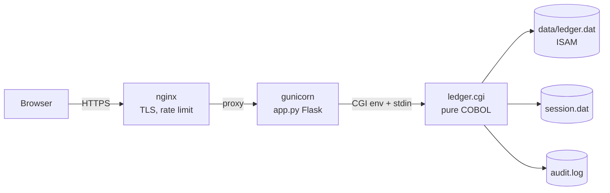

# 📜 The Ledger of Ages

[](https://github.com/Alexandru2984/cobol/actions/workflows/ci.yml)

A personal finance ledger web application whose **entire backend is written in pure COBOL** (GnuCOBOL), storing data in native **ISAM indexed files** and speaking **CGI** — deployed in production behind nginx + gunicorn.

Live at [cobol.micutu.com](https://cobol.micutu.com).

---

## ✨ Features

- **Full CRUD** — add, edit (pre-filled form), and delete transactions
- **Authentication** — login with server-side session tokens (`openssl rand`), HttpOnly/Secure/SameSite=Strict cookies, and 8-hour server-side session expiry
- **Filtering & sorting** — by category, by date range (using the ISAM *alternate key* on date), sorted by ID or date
- **Monthly report** — income/expense/net per month with a pure-CSS bar chart (zero JavaScript)
- **CSV export** — respects active filters, proper RFC-4180 quoting, all generated in COBOL
- **Audit log** — every login (including failures, with IP), add, update, delete, and export is appended to `data/audit.log` and browsable in-app
- **Category summary cards** and running balance
- **Input validation in COBOL** — date format + month/day ranges, amount syntax and bounds, category whitelist
- **XSS-safe** — hand-written HTML-escaping and URL-decoding routines in COBOL

## 🛠️ Technology Stack

| Layer | Technology |
|---|---|
| Business logic | [GnuCOBOL](https://gnucobol.sourceforge.io/) (`cobc`), free format |
| Database | ISAM (`ORGANIZATION IS INDEXED`), primary key + alternate key with duplicates |
| Interface | CGI — HTTP headers and HTML written directly to `stdout` |
| WSGI bridge | Flask (translates HTTP ⇄ CGI env vars + stdin/stdout) |
| Serving | gunicorn (systemd service) behind nginx with TLS + rate limiting |
| Tests / CI | pytest (end-to-end through the real compiled binary) + GitHub Actions |

## 🏗️ Architecture



`app.py` spawns the compiled COBOL binary per request, passing `REQUEST_METHOD`, `QUERY_STRING`, `HTTP_COOKIE`, `CONTENT_LENGTH`, and the client IP (`REMOTE_ADDR`, taken from nginx's `X-Real-IP`). The COBOL program parses the query string and POST body (URL-decoding included), enforces auth, executes the action against the ISAM files, and prints a full HTTP response.

## 📂 Project Structure

```
ledger.cbl        # the whole application: routing, auth, CRUD, reports, CSV, audit
seed.cbl          # demo data seeder (refuses to overwrite unless SEED_FORCE=1)
hello.cbl         # minimal CGI proof-of-concept
app.py            # Flask/WSGI-to-CGI bridge + /health endpoint
tests/            # pytest end-to-end suite (compiles its own binary, isolated data dir)
Makefile          # build / test / demo / deploy targets
deploy.sh         # compile -> test -> atomic install -> restart -> health check
backup.sh         # daily snapshots of ISAM files + audit log (7-day retention)
run_demo.sh       # sandboxed demo in a temp dir (never touches real data)
```

## 🚀 Quick Start

```bash
sudo apt update && sudo apt install -y gnucobol python3-venv
python3 -m venv venv && venv/bin/pip install -r requirements.txt -r requirements-dev.txt

make build        # compile ledger.cgi, seed, hello.cgi
./seed            # populate demo data (guarded against overwriting)
make test         # run the end-to-end suite
venv/bin/python app.py   # serve on http://127.0.0.1:5000
```

Default credentials are `micu` / `cobol2026` unless overridden via `LEDGER_USER` / `LEDGER_PASS` (in production these come from `.env` via systemd `EnvironmentFile`).

## 🧪 Tests

`tests/test_ledger.py` exercises the real compiled binary through the Flask bridge: login/logout, session expiry and tampering, full CRUD, filters, CSV quoting, monthly report math, audit trail, XSS escaping, and input validation — 13 scenarios, all hitting actual ISAM files in a temp dir. CI compiles everything and runs the suite on every push.

## 🔐 Security Notes

- Session tokens are 128-bit from `openssl rand`, stored server-side with an absolute expiry; cookie is `HttpOnly; Secure; SameSite=Strict` (which also mitigates CSRF)
- All user input is URL-decoded then HTML-escaped by dedicated COBOL routines; control characters from `%XX` sequences are rejected
- Failed logins are rate-limited by nginx (`limit_req`) and recorded with source IP in the audit log
- Credentials live in `.env` (git-ignored), injected by systemd
- Known limitations (single-user by design): one active session at a time, plaintext credential comparison server-side

## 📦 Production Deployment

- `cobol.service` (systemd) runs gunicorn on `127.0.0.1:9001` with `EnvironmentFile=.env`
- nginx terminates TLS (Let's Encrypt), rate-limits, and proxies to gunicorn
- `./deploy.sh` — compile, run the full test suite, atomically swap binaries, restart, verify `/health`
- `backup.sh` runs daily from cron (03:00), keeps 7 days of snapshots in `data/backups/`
- `/health` is a JSON endpoint for uptime monitoring

---
*Started as a "modern vintage" programming experiment; grown into a small but complete production app — proof that COBOL can still ship in 2026.*
